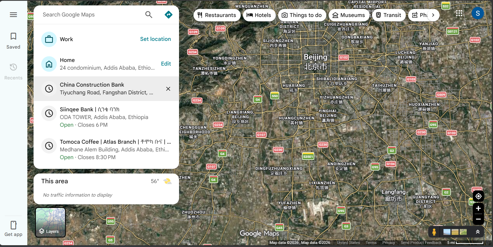
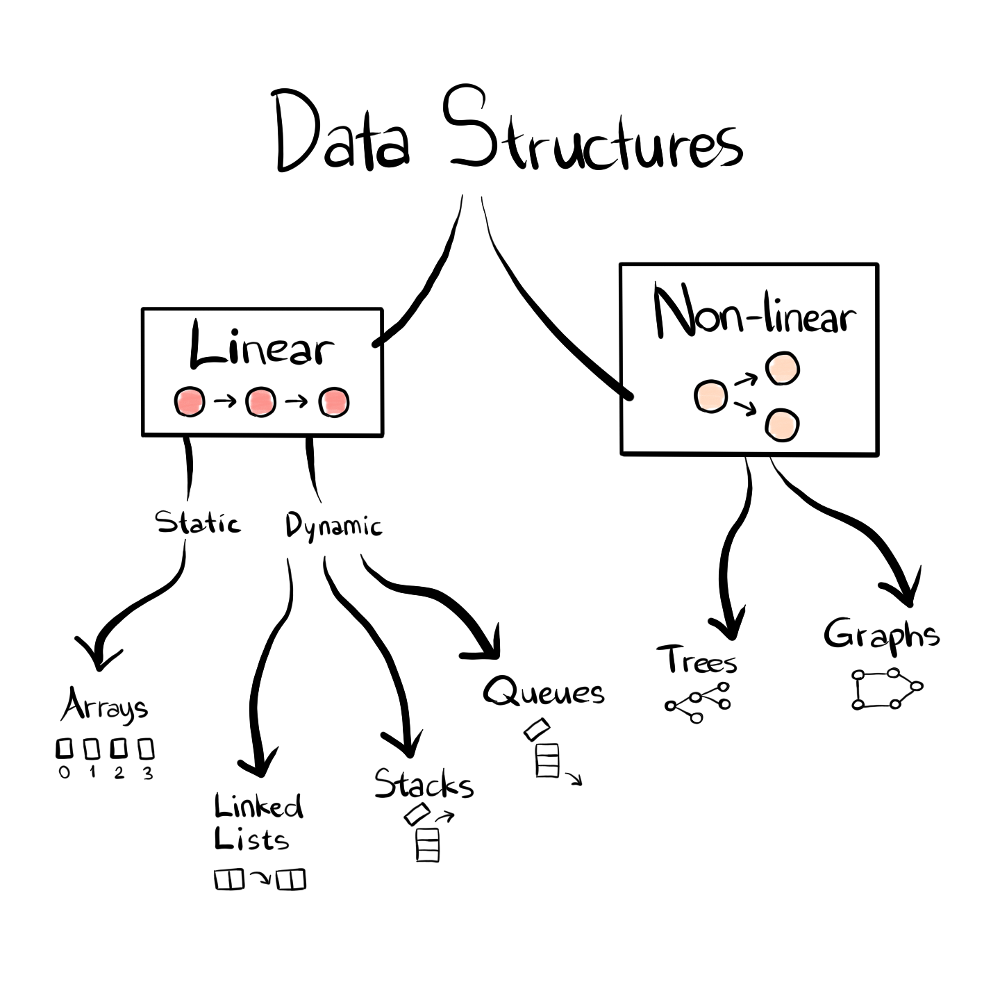
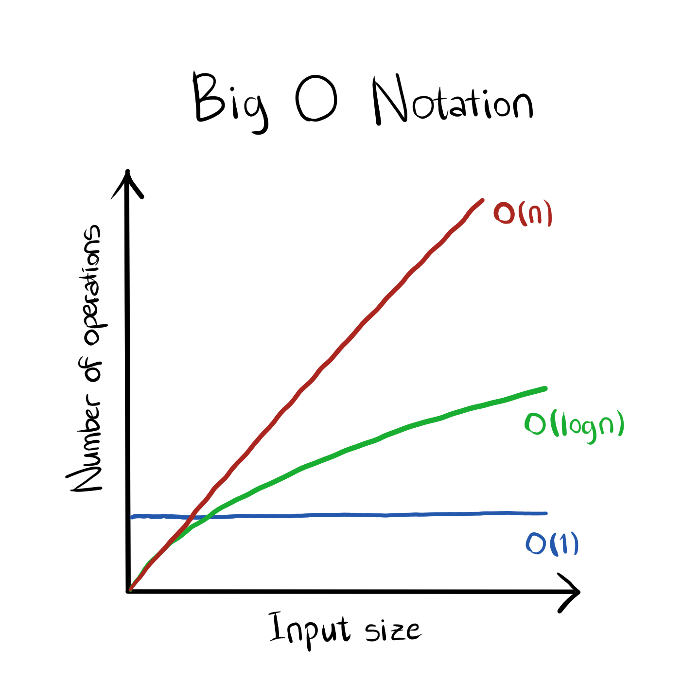

# Contents

1 Introduction to Data Structures                                           
-----------------------------------------------------------------------------
        Definition of Data Structures                                       
        Importance of Data Structures in Programming                        
        Classification of Data Structures                                  

2 Complexity Analysis in Data Structures                                   
-----------------------------------------------------------------------------
        Time and Space Complexity                                          
            Big O Notation: O(1), O(log n), O(n), O(n log n), O(n²)        

3 Linear Data Structures                                                   
-----------------------------------------------------------------------------
        Static Data Structures                                             
            Arrays                                                         
        Dynamic Data Structures                                            
            Linked Lists                                                   
            Stacks                                                         
            Queues                                                         

4 Non-linear Data Structures                                               
-----------------------------------------------------------------------------
        Types of Non-linear Data Structures                                
        Trees                                                              
            Binary trees                                                   
        Graphs                                                             

5 Hash Tables                                                              
-----------------------------------------------------------------------------
        Hash Functions and Their Importance                                

---

# 1 Introduction to Data Structures

---

## What is a Data Structure?

A data structure is a specialized layout for organizing, storing, and managing data in a computer's memory so that it can be accessed and modified efficiently.

Think of it as a physical container or filing system designed for specific types of information. Just as you would store clothes in a wardrobe, documents in a filing cabinet, and tools in a toolbox, you choose specific data structures based on how you intend to search, sort, and update your data.

Without data structures, programs would treat memory as an unstructured block of bytes, making even simple operations like searching or sorting excruciatingly slow.

---

## Importance of Data Structures in Programming

Choosing the right data structure directly impacts software performance, scalability, and resource usage. A well-chosen data structure provides four primary advantages:

* **Saves Memory:** Utilizes space efficiently to minimize memory overhead and prevent wasteful allocations.


* **Speeds Things Up:** Dramatically reduces execution time and computational steps for retrieving or updating information.


* **Organizes Data:** Keeps relationships between data points clean, intuitive, and easy to maintain.


* **Supports Complex Tasks:** Enables advanced operations like pathfinding, transaction logging, network routing, and real-time query processing.


---

## Real-World Applications

Data structures power nearly every digital tool and platform you interact with every day. Here is where they appear in real-world software:

### 1. Social Media & Content Streaming

Platforms like YouTube and Spotify store user preference histories and media catalogs using hash tables, graphs, and trees. These structures enable near-instant recommendations based on your historical likes and engagement.

```
[ User Interaction ] ──> [ Liked Video History ] ──> [ Recommendation Engine (Graph/Hash Table) ]

```

### 2. Navigation & Mapping

Google Maps models physical environments as graphs, where intersections act as vertices (nodes) and roads act as weighted edges. Graph traversal algorithms process these networks to compute the fastest route in real time.

```
[ Origin Node ] ──( Distance: 5km )──> [ Waypoint Node ] ──( Distance: 3km )──> [ Destination Node ]

```


### 3. E-Commerce Platforms

Online storefronts use hash maps to catalog inventory items by product ID and trees to manage hierarchical category filtering (e.g., Electronics > Audio > Headphones).

```
[ Product Catalog ] ──> [ Category Tree ] ──> [ Inverted Index / Hash Table for Instant Search ]

```


### 4. Database Cataloging

Libraries, academic databases, and large enterprise databases utilize B-trees and hash indexes to locate records across millions of rows without performing slow, full-table scans.

---

## Classification of Data Structures

Data structures fall into two main categories: **Linear** and **Non-Linear** structures.

 

### 1. Linear Data Structures

Elements are arranged sequentially, where each element is connected to its preceding and succeeding elements.

* **Static:** Memory size is fixed at allocation time (e.g., Arrays).


* **Dynamic:** Memory size can expand or shrink dynamically during execution (e.g., Linked Lists, Stacks, Queues).


### 2. Non-Linear Data Structures

Elements are organized hierarchically or interconnected as a network rather than sequentially.

* Examples include **Trees** (hierarchical parent-child nodes) and **Graphs** (interconnected networks).


---

# 2 Complexity Analysis in Data Structures

---

## Time and Space Complexity

When evaluating an algorithm or data structure, we measure efficiency using two parameters:

* **Time Complexity:** Quantifies the total time or computational steps required by an algorithm as a function of the input size $n$.
* **Space Complexity:** Quantifies the amount of working memory or storage space required by an algorithm as a function of the input size $n$.

---

## Big O Notation

Big O notation describes the upper bound or worst-case scenario of an algorithm's resource consumption as the input size grows toward infinity.



### 1. Constant Time: $O(1)$

The operation takes the exact same amount of time regardless of how large the dataset is.

* **Example:** Accessing an array element by its index, or popping an element from a stack.


### 2. Logarithmic Time: $O(\log n)$

The execution time grows logarithmically relative to the input size; each step reduces the problem size by half.

* **Example:** Binary Search on a sorted array.


### 3. Linear Time: $O(n)$

Execution time scales directly and linearly with the number of input items $n$.

* **Example:** Iterating through an unsorted array to find a specific element.


### 4. Linearithmic Time: $O(n \log n)$

Slightly slower than linear time, typical of optimal comparison-based sorting routines.

* **Example:** Merge Sort and Quick Sort.


### 5. Quadratic Time: $O(n^2)$

Execution time scales quadratically with input size, often caused by nested loops over the data.

* **Example:** Bubble Sort, Insertion Sort, and Selection Sort.


# 3 Linear Data Structures

---

## Static Data Structures

---

### Arrays

An array is a collection of elements stored at contiguous memory locations, where each item can be accessed directly using an integer index.

```
Index:    0      1      2      3      4
       ┌──────┬──────┬──────┬──────┬──────┐
Data:  │  10  │  20  │  30  │  40  │  50  │
       └──────┴──────┴──────┴──────┴──────┘
Memory: 0x100  0x104  0x108  0x10C  0x110

```

#### Core Characteristics

* **Contiguous Memory:** All elements are stored side-by-side in computer memory.


* **Fixed Size:** Array dimensions must be declared upfront and cannot grow or shrink dynamically in static arrays.


* **Fast Indexing:** Calculating the memory address of index $i$ requires simple arithmetic: $\text{Address} = \text{Base Address} + (i \times \text{Element Size})$.

#### Core Operations

* **Access:** $O(1)$ — Immediate retrieval via index calculation.
* **Search:** $O(n)$ — Linear traversal required for unsorted arrays.
* **Insertion:** $O(n)$ — Requires shifting subsequent elements rightward.
* **Deletion:** $O(n)$ — Requires shifting subsequent elements leftward.

---

## Dynamic Data Structures

---

### Linked Lists

A linked list is a linear data structure where elements (called **nodes**) are stored non-contiguously in memory. Each node consists of two parts: data and a pointer (reference) to the next node.

```
Head
 │
 ▼
┌──────┬──────┐    ┌──────┬──────┐    ┌──────┬──────┐
│ Data │ Next ├───>│ Data │ Next ├───>│ Data │ Null │
├──────┼──────┤    ├──────┼──────┤    ├──────┼──────┤
│  10  │ 0x02 │    │  20  │ 0x03 │    │  30  │ 0x00 │
└──────┴──────┘    └──────┴──────┘    └──────┴──────┘

```

#### Types of Linked Lists

1. **Singly Linked List:** Nodes contain a data field and a single forward pointer.


2. **Doubly Linked List:** Nodes contain two pointers—one pointing to the next node and one pointing to the previous node.
3. **Circular Linked List:** The final node's pointer references the head node rather than pointing to `Null`.

#### Advantages over Arrays

* Dynamic size allocation with no pre-allocated memory waste.


* Instant $O(1)$ insertions and deletions when the node pointer is known.

---

### Stacks

A stack is a linear dynamic data structure operating on a strict **Last-In, First-Out (LIFO)** protocol. The last element added to the stack is always the first one to be removed.

```
        │  Data C  │  ▲ Top (Pushed Last / Popped First)
        ├──────────┤  │
        │  Data B  │  │
        ├──────────┤  │
        │  Data A  │  │ Bottom
        └──────────┘  

```

#### Primary Operations

* **Push:** Inserts a new element onto the top of the stack — $O(1)$.


* **Pop:** Removes and returns the top element — $O(1)$.


* **Peek/Top:** Inspects the top element without removing it — $O(1)$.

#### Real-World Applications

* Undo/Redo mechanisms in text editors.
* Back/Forward browser history management.
* Function call stack management in programming language runtimes.

---

### Queues

A queue is a linear dynamic data structure operating on a strict **First-In, First-Out (FIFO)** protocol. The first element added to the queue is the first one to be processed.

```
               Enqueue (Insert)                             Dequeue (Remove)
               ───────────────>                             ───────────────>
┌────────┐    ┌────────┬────────┬────────┬────────┬────────┐    ┌────────┐
│ Incoming│───>│ Element│ Element│ Element│ Element│ Element│───>│ Outgoing│
└────────┘    └────────┴────────┴────────┴────────┴────────┘    └────────┘
               Rear (Tail)                         Front (Head)

```

#### Primary Operations

* **Enqueue:** Adds an item to the rear of the queue — $O(1)$.


* **Dequeue:** Removes an item from the front of the queue — $O(1)$.


* **Front:** Inspects the front item without removing it — $O(1)$.

#### Real-World Applications

* CPU job scheduling and task queues.
* Printer spooling (documents printed in order received).
* Web server request processing queues.

---

# 4 Non-Linear Data Structures

---

## Overview of Non-Linear Data Structures

Unlike linear structures, non-linear data structures arrange elements hierarchically or as interconnected networks. They are designed to model complex relationships where items do not follow a simple sequential sequence.

---

## Trees

A tree is a hierarchical, non-linear data structure consisting of nodes connected by directed or undirected edges, starting from a single root node.

```
                     ┌──────────┐
                     │  Root    │  (Level 0)
                     └────┬─────┘
             ┌────────────┴────────────┐
             ▼                         ▼
       ┌──────────┐              ┌──────────┐
       │ Node A   │              │ Node B   │  (Level 1)
       └────┬─────┘              └────┬─────┘
     ┌──────┴──────┐                  │
     ▼             ▼                  ▼
┌──────────┐  ┌──────────┐      ┌──────────┐
│ Leaf C   │  │ Leaf D   │      │ Leaf E   │  (Level 2)
└──────────┘  └──────────┘      └──────────┘

```

#### Key Terminologies

* **Root:** Topmost node of the tree without parent edges.


* **Parent / Child:** Connected nodes where the upper node is the parent.


* **Leaf Node:** A node that has zero children.


* **Depth:** The number of edges from the root to a specific node.
* **Height:** The maximum number of edges from a node to a leaf.

---

## Binary Search Trees (BST)

A Binary Search Tree is a binary tree in which every node satisfies the **BST Ordering Property**:

* The value of any node in the **left subtree** is strictly less than the node's value.


* The value of any node in the **right subtree** is strictly greater than the node's value.


```
                     ┌──────────┐
                     │    50    │
                     └────┬─────┘
             ┌────────────┴────────────┐
             ▼                         ▼
       ┌──────────┐              ┌──────────┐
       │    30    │              │    70    │
       └────┬─────┘              └────┬─────┘
     ┌──────┴──────┐            ┌──────┴──────┐
     ▼             ▼            ▼             ▼
┌──────────┐  ┌──────────┐ ┌──────────┐  ┌──────────┐
│    20    │  │    40    │ │    60    │  │    80    │
└──────────┘  └──────────┘ └──────────┘  └──────────┘

```

#### Performance Characteristics

* **Search / Insert / Delete (Balanced):** $O(\log n)$ average time complexity.


* **Search / Insert / Delete (Unbalanced/Degenerate):** $O(n)$ worst-case time complexity.

---

## Graphs

A graph is a non-linear network structure composed of a set of vertices (or nodes) $V$ and a set of edges $E$ that connect pairs of vertices.

```
    (A) ───────────── (B)
     │                 │
     │                 │
     │                 │
    (C) ───────────── (D)

```

#### Core Classifications

1. **Directed Graph (Digraph):** Edges have directions (one-way connections).
2. **Undirected Graph:** Edges are bidirectional (two-way connections).
3. **Weighted Graph:** Edges carry numerical values representing cost, distance, or latency.


4. **Unweighted Graph:** All edges carry equal weight.

#### Representations

* **Adjacency Matrix:** A 2D grid storing 1s and 0s indicating connected vertex pairs.
* **Adjacency List:** An array of linked lists where index $i$ stores all vertices adjacent to vertex $i$.

---

# 5 Hash Tables

---

## Concept of Hash Tables

A Hash Table (or Hash Map) is an associative data structure that maps key-value pairs for extremely fast data retrieval. It uses a mathematical transformation called a **Hash Function** to convert a lookup key into a numerical index within an underlying storage array.

```
Key ("John") ───> [ Hash Function ] ───> Index 3 ───> Array[3] = "555-0199"

```

---

## Hash Functions and Their Importance

A effective hash function must satisfy three criteria:

* **Deterministic:** The exact same input key must always yield the exact same numerical index.


* **Uniform Distribution:** Keys should be evenly distributed across available array slots to prevent clustering.


* **Fast Computation:** The function must execute quickly in constant $O(1)$ time.


---

## Collision Resolution Strategies

A **collision** occurs when two distinct keys generate the exact same array index.

```
Key 1 ("Alice") ──┐
                  ├─> [ Hash Function ] ──> Index 5  (COLLISION!)
Key 2 ("Bob")   ──┘

```

### 1. Chaining (Open Hashing)

Each array slot holds a pointer to a singly linked list. When keys collide, the new key-value pair is appended to the linked list at that specific index.

```
Index 0: 
Index 1: [ KeyA | ValA ] ──> [ KeyB | ValB ] ──> Null
Index 2: 
Index 3: [ KeyC | ValC ] ──> Null

```

### 2. Open Addressing (Closed Hashing)

When a collision happens, the system searches for the next available array index according to a probing sequence:

* **Linear Probing:** Checks index $i+1, i+2, i+3...$ sequentially until an empty slot is found.


* **Quadratic Probing:** Checks index $i+1^2, i+2^2, i+3^2...$ to reduce primary clustering.


* **Double Hashing:** Uses a secondary hash function to compute variable probing step sizes.
