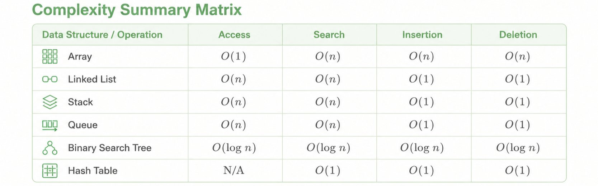
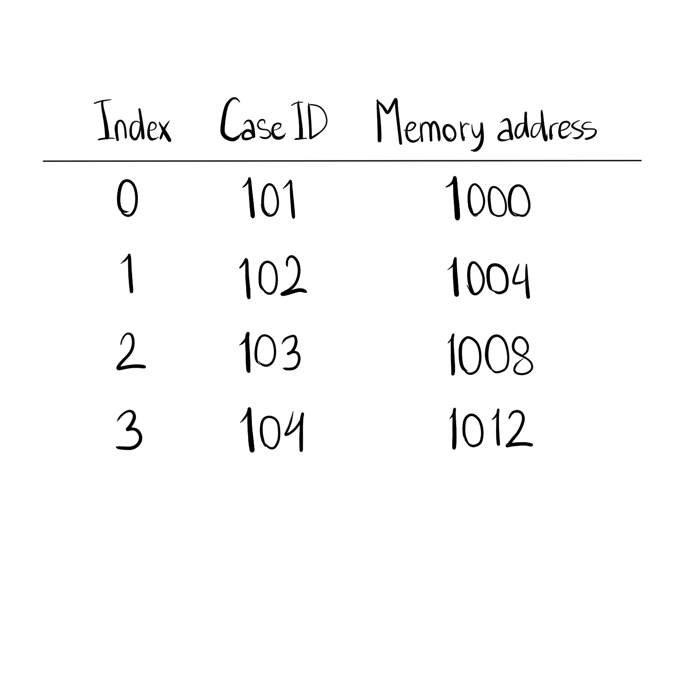
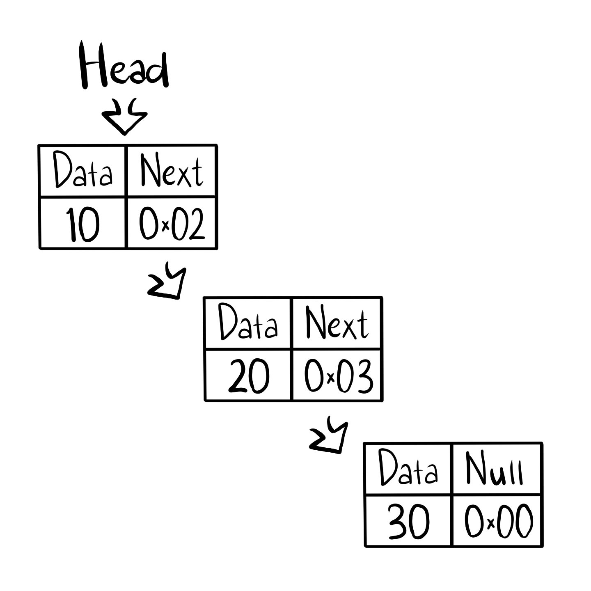

# Contents

1. [Introduction to Data Structures](#1-introduction-to-data-structures)
   - [What is a Data Structure?](#what-is-a-data-structure)
   - [Importance and Applications](#importance-of-data-structures-in-programming)
   - [Classification of Data Structures](#classification-of-data-structures)
2. [Complexity Analysis](#2-complexity-analysis-in-data-structures)
   - [Big O Notation](#big-o-notation)
   - [Complexity Summary Matrix](#complexity-summary-matrix)
3. [Linear Data Structures](#3-linear-data-structures)
   - [Arrays and Contiguous Memory](#arrays)
   - [Linked Lists](#linked-lists)
   - [Stacks](#stacks)
   - [Queues](#queues)
4. [Non-Linear Data Structures](#4-non-linear-data-structures)
   - [Graphs](#graphs)
5. [Hash Tables](#5-hash-tables)
6. [Essential Algorithms](#6-essential-algorithms)
   - [Linear and Binary Search](#linear-search-and-binary-search)
   - [Breadth-First Search and Depth-First Search](#breadth-first-search-bfs-and-depth-first-search-dfs)

> **Illustration note:** All final instructional diagrams should be hand-drawn by a team member. Existing text sketches are temporary references. Replace each **HAND-DRAWN DIAGRAM TODO** note with a checked, labeled illustration before submission.

---

# 1 Introduction to Data Structures

---

## What is a Data Structure?

A **data structure** is a specialized layout for organizing, storing, and managing data in a computer's memory so that it can be accessed and modified efficiently.

Think of it as a physical container or filing system designed for specific types of information. Just as you would store clothes in a wardrobe, documents in a filing cabinet, and tools in a toolbox, you choose specific data structures based on how you intend to search, sort, and update your data.

Without data structures, programs would treat memory as an unstructured block of bytes, making even simple operations like searching or sorting excruciatingly slow.

---

## Importance of Data Structures in Programming

Choosing the right data structure directly impacts software performance, scalability, and resource usage. A well-chosen data structure provides four primary advantages:

- **Saves Memory:** Utilizes space efficiently to minimize memory overhead and prevent wasteful allocations.
- **Speeds Things Up:** Dramatically reduces execution time and computational steps for retrieving or updating information.
- **Organizes Data:** Keeps relationships between data points clean, intuitive, and easy to maintain.
- **Supports Complex Tasks:** Enables advanced operations like pathfinding, transaction logging, network routing, and real-time query processing.

---

## Real-World Applications

Data structures are used to organize information efficiently. Different structures are suitable for different tasks.

### 1. Organizing Case Records — Hash Tables

Imagine a fictional FBI analyst searching for a case using its unique identification number.

A **hash table** allows the analyst to retrieve the associated record efficiently using its exact ID.

This is an example of data retrieval, not facial recognition or biometric matching.

### 2. Investigating Connections — Graphs

An investigation may involve relationships between fictional individuals, locations, and events.

A **graph** can represent these relationships:

- **Nodes** represent individuals or locations.
- **Edges** represent connections between them.

Algorithms such as BFS and DFS can then explore the graph systematically.

### 3. Managing Tasks — Stacks and Queues

Different tasks may require different processing orders.

- **Stack (LIFO):** Useful when exploring a path and backtracking, as in DFS.
- **Queue (FIFO):** Useful when processing tasks in arrival order, as in BFS.

These examples demonstrate how choosing the right data structure supports efficient problem-solving.


---

## Classification of Data Structures

Data structures can be divided into two main categories: **Linear** and **Non-Linear**.


### 1. Linear Data Structures

Linear data structures organize elements in a sequence.

- **Array:** Stores elements in indexed positions.
- **Linked List:** Connects elements using references.
- **Stack:** Follows Last-In, First-Out (LIFO).
- **Queue:** Follows First-In, First-Out (FIFO).

### 2. Static vs. Dynamic Storage

Static and dynamic describe how storage is allocated or managed, not whether a structure follows LIFO or FIFO.

- **Fixed-size storage:** Has a predetermined capacity.
- **Dynamically growing storage:** Can expand as more elements are added, subject to available memory.

**Important:** Stacks and queues can be implemented using arrays or linked lists. They are not automatically dynamic.

### 3. Non-Linear Data Structures

Non-linear structures represent relationships that do not follow a single sequence.

- **Trees:** Organize information hierarchically.
- **Graphs:** Connect nodes through edges.

Graphs will be explored further when introducing **Breadth-First Search (BFS)** and **Depth-First Search (DFS)**.

### Data Structure Classification Diagram

 


**Remember:** Linear versus non-linear describes organization. Fixed-size versus dynamically growing describes storage. Stacks and queues can have either kind of implementation.

---

# 2 Complexity Analysis in Data Structures

---

## Time and Space Complexity

When evaluating an algorithm or data structure, we measure efficiency using two parameters:

- **Time Complexity:** Quantifies the total time or computational steps required by an algorithm as a function of the input size $n$.
- **Space Complexity:** Quantifies the amount of working memory or storage space required by an algorithm as a function of the input size $n$.

---

## Big O Notation

**Big O** notation describes an **asymptotic upper bound** on how an algorithm's time or memory usage grows as the input size increases.

Although Big O is commonly used to describe worst-case complexity, it does not automatically mean "worst case." It can describe the growth of best-case, average-case, or worst-case resource usage, depending on what is being analyzed.

For example, O(1) means the amount of work stays bounded as the input grows. It does **not** mean an operation always takes exactly the same amount of real-world time.


### 1. Constant Time: $O(1)$

The amount of work remains bounded as the dataset grows; the exact execution time may vary.

- **Example:** Accessing an array element by its index, or popping an element from a stack.

### 2. Logarithmic Time: $O(\log n)$

The execution time grows logarithmically relative to the input size; each step reduces the problem size by half.

- **Example:** Binary Search on a sorted array.

### 3. Linear Time: $O(n)$

Execution time scales directly and linearly with the number of input items $n$.

- **Example:** Iterating through an unsorted array to find a specific element.

### 4. Linearithmic Time: $O(n \log n)$

Slightly slower than linear time, typical of optimal comparison-based sorting routines.

- **Example:** Merge Sort and Quicksort in its average case (Quicksort can take O(n²) in the worst case).

### 5. Quadratic Time: $O(n^2)$

Execution time scales quadratically with input size, often caused by nested loops over the data.

- **Example:** Bubble Sort, Insertion Sort, and Selection Sort.



# 3 Linear Data Structures

---

## Arrays and Contiguous Storage

---

### Arrays

An **array** is a collection of elements stored at contiguous memory locations, where each item can be accessed directly using an integer index.

### Why Contiguous Memory Matters

In a fixed-length array, elements of the same size are stored next to one another in memory. This is called **contiguous memory allocation**.

For example, imagine an array containing four fictional FBI case IDs:



Assume each ID occupies 4 bytes and the first element begins at address 1000.

To access the element at index 2, the computer can calculate its address:

Address = 1000 + (2 × 4) = 1008

**Why is this useful?**

- **Fast access:** The location of an element can be calculated directly from its index, giving O(1) indexed access.
- **Efficient storage:** Elements occupy consecutive memory locations, which can improve cache efficiency.
- **Limitation:** Inserting an element in the middle may require shifting other elements, taking O(n) time.

**Comparison with linked lists:**

Arrays store elements in consecutive locations, while linked-list nodes can occupy different memory locations and use references to connect them. Finding the element at a particular position in a linked list generally requires traversing nodes, taking O(n) time.

**Important distinction:** Accessing a known array index is O(1), but searching an unsorted array for a particular value generally takes O(n) time.

**Beginner Question:**

If an array begins at address 2000 and each element occupies 4 bytes, what is the address of index 3?

**Answer:**

2000 + (3 × 4) = 2012.

```
Index:    0      1      2      3      4
       ┌──────┬──────┬──────┬──────┬──────┐
Data:  │  10  │  20  │  30  │  40  │  50  │
       └──────┴──────┴──────┴──────┴──────┘
Memory: 0x100  0x104  0x108  0x10C  0x110
```

#### Core Characteristics

- **Contiguous Memory:** All elements are stored side-by-side in computer memory.
- **Fixed Size:** Array dimensions must be declared upfront and cannot grow or shrink dynamically in static arrays.
- **Fast Indexing:** Calculating the memory address of index $i$ requires simple arithmetic: $\text{Address} = \text{Base Address} + (i \times \text{Element Size})$.

#### Core Operations

- **Access:** $O(1)$ — Immediate retrieval via index calculation.
- **Search:** $O(n)$ — Linear traversal required for unsorted arrays.
- **Insertion:** $O(n)$ — Requires shifting subsequent elements rightward.
- **Deletion:** $O(n)$ — Requires shifting subsequent elements leftward.

---

## Linked Lists, Stacks, and Queues

---

### Linked Lists

A **linked list** is a linear data structure made up of individual elements called **nodes**. Each node stores data and, in a singly linked list, a reference (pointer) to the next node.

Unlike arrays, linked-list nodes do not need to occupy consecutive memory locations. Instead, pointers connect them in the correct order.

For example, a fictional FBI investigation could use a linked list to keep track of case records. Each node contains a case ID and a reference to the next record.

#### Linked Lists: Brief Comparison

For this module, we focus on **singly linked lists**, where each node contains data and a reference to the next node.

Other variations exist, such as doubly linked and circular linked lists, but their implementation details are outside our scope.

The key distinction is that arrays support direct indexing, while linked lists connect nodes through references.



#### Types of Linked Lists

1. **Singly Linked List:** Nodes contain a data field and a single forward pointer.
2. **Doubly Linked List:** Nodes contain two pointers—one pointing to the next node and one pointing to the previous node.
3. **Circular Linked List:** The final node's pointer references the head node rather than pointing to `Null`.

#### Advantages and Limitations Compared with Arrays

**Advantages:**

- **Flexible size:** Linked lists can grow or shrink by adding or removing nodes without reallocating one contiguous block for the entire list.
- **Efficient insertion:** Inserting a node can take O(1) time when the required position and references are already known.
- **Efficient deletion:** Removing a node can take O(1) time when the necessary references are available.

**Limitations:**

- **Slower access:** Finding an element by its position generally requires following nodes one by one, taking O(n) time.
- **Extra memory:** Each node requires additional storage for one or more pointers.
- **Searching required:** Finding a particular node may take O(n), even when the insertion or deletion itself is O(1).

**Important:** In a singly linked list, deleting a node generally requires access to the preceding node so its pointer can be updated.

#### Beginner Question

An array and a linked list both contain 100 fictional case records. Which structure is generally faster for directly accessing the record at index 50?

**Answer:** The array, because it provides O(1) access by index. A linked list generally requires O(n) traversal.

---

### Stacks

A **stack** is a linear data structure that follows the **Last-In, First-Out (LIFO)** principle. The last item added is the first item removed.

Stacks can be implemented using arrays or linked lists. Their defining feature is the order in which items are added and removed, not whether their storage is static or dynamic.

```
        │  Data C  │  ▲ Top (Pushed Last / Popped First)
        ├──────────┤  │
        │  Data B  │  │
        ├──────────┤  │
        │  Data A  │  │ Bottom
        └──────────┘
```

> **✏️ HAND-DRAWN DIAGRAM TODO — Stack:** Illustrate A, B, C with the top labeled and push/pop arrows showing LIFO.

#### FBI Example: Investigating Leads

Imagine an investigator places three fictional case leads onto a stack:

1. Lead A is added.
2. Lead B is added.
3. Lead C is added.

Because stacks follow LIFO, the investigator processes **Lead C first**, **followed by B** and **then A**.

**Connection to algorithms:** Depth-First Search (DFS) can use a stack to explore one path before backtracking.

**Beginner Question:** If A, B, and C are pushed onto a stack in that order, which item is popped first?

**Answer:** C, because it was added last.

#### Primary Operations

- **Push:** Inserts a new element onto the top of the stack — $O(1)$.
- **Pop:** Removes and returns the top element — $O(1)$.
- **Peek/Top:** Inspects the top element without removing it — $O(1)$.

#### Real-World Applications

- Undo/Redo mechanisms in text editors.
- Back/Forward browser history management.
- Function call stack management in programming language runtimes.

---

### Queues

A **queue** is a linear data structure that follows the **First-In, First-Out (FIFO)** principle. The first item added is the first item removed.

Like stacks, queues can be implemented using arrays or linked lists. Their defining feature is the order in which items are processed.

#### FBI Example: Processing Evidence

Imagine three fictional evidence records arrive in this order:

1. Evidence A arrives first.
2. Evidence B arrives second.
3. Evidence C arrives third.

In a FIFO processing queue, the records are processed in the order **A → B → C**.

**Connection to algorithms:** Breadth-First Search (BFS) uses a queue to explore nodes level by level.

**Beginner Question:** If A, B, and C enter a queue in that order, which item is removed first?

**Answer:** A, because it entered the queue first.

```
               Enqueue (Insert)                             Dequeue (Remove)
               ───────────────>                             ───────────────>
┌────────┐    ┌────────┬────────┬────────┬────────┬────────┐    ┌────────┐
│ Incoming│───>│ Element│ Element│ Element│ Element│ Element│───>│ Outgoing│
└────────┘    └────────┴────────┴────────┴────────┴────────┘    └────────┘
               Rear (Tail)                         Front (Head)
```

> **✏️ HAND-DRAWN DIAGRAM TODO — Queue:** Draw a FIFO queue showing A, B, and C, with front/rear labels and enqueue/dequeue arrows.

#### Primary Operations

- **Enqueue:** Adds an item to the rear of the queue — $O(1)$.
- **Dequeue:** Removes an item from the front of the queue — $O(1)$.
- **Front:** Inspects the front item without removing it — $O(1)$.

#### Real-World Applications

- CPU job scheduling and task queues.
- Printer spooling (documents printed in order received).
- Web server request processing queues.

---

# 4 Non-Linear Data Structures

---

## Overview of Non-Linear Data Structures

Unlike linear data structures, **non-linear structures** organize information through hierarchical or interconnected relationships.

Two examples are **trees** and **graphs**.

- **Trees:** Organize nodes hierarchically through parent-child relationships.
- **Graphs:** Represent connections between nodes, making them useful for modeling relationships and networks.

This module focuses on **graphs**, since they are directly connected to Breadth-First Search (BFS) and Depth-First Search (DFS). Detailed tree structures are outside our scope.

```
                     ┌──────────┐
                     │  Root    │  (Level 0)
                     └────┬─────┘
             ┌────────────┴────────────┐
             ▼                         ▼
       ┌──────────┐              ┌──────────┐
       │ Node A   │              │ Node B   │  (Level 1)
       └────┬─────┘              └────┬─────┘
     ┌──────┴──────┐                  │
     ▼             ▼                  ▼
┌──────────┐  ┌──────────┐      ┌──────────┐
│ Leaf C   │  │ Leaf D   │      │ Leaf E   │  (Level 2)
└──────────┘  └──────────┘      └──────────┘
```

```
                     ┌──────────┐
                     │    50    │
                     └────┬─────┘
             ┌────────────┴────────────┐
             ▼                         ▼
       ┌──────────┐              ┌──────────┐
       │    30    │              │    70    │
       └────┬─────┘              └────┬─────┘
     ┌──────┴──────┐            ┌──────┴──────┐
     ▼             ▼            ▼             ▼
┌──────────┐  ┌──────────┐ ┌──────────┐  ┌──────────┐
│    20    │  │    40    │ │    60    │  │    80    │
└──────────┘  └──────────┘ └──────────┘  └──────────┘
```

---

## Graphs

A **graph** is a non-linear network structure composed of a set of vertices (or nodes) $V$ and a set of edges $E$ that connect pairs of vertices.

```
    (A) ───────────── (B)
     │                 │
     │                 │
     │                 │
    (C) ───────────── (D)
```

> **✏️ HAND-DRAWN DIAGRAM TODO — Graph:** Draw the original four-node graph with labeled vertices A–D and undirected edges.

#### Core Classifications

1. **Directed Graph (Digraph):** Edges have directions (one-way connections).
2. **Undirected Graph:** Edges are **bidirectional** (two-way connections).
3. **Weighted Graph:** Edges carry numerical values representing cost, distance, or latency.
4. **Unweighted Graph:** All edges carry equal weight.

#### Representations

- **Adjacency Matrix:** A 2D grid storing 1s and 0s indicating connected vertex pairs.
- **Adjacency List:** An array of linked lists where index $i$ stores all vertices adjacent to vertex $i$.

---

# 5 Hash Tables

---

## Concept of Hash Tables

A **hash table** (or hash map) is a data structure that stores information as **key-value pairs**.

A **key** is used to find its associated value. A **hash function** converts the key into a number that helps determine where the information is stored in an **underlying array**.

For example, in a fictional FBI investigation, a case ID could serve as the key, while the corresponding case record is the value.

Hash tables provide **expected O(1) lookup** under suitable conditions, making them useful for retrieving information efficiently from large collections of records.

**Important:** Hash tables are designed for exact-key retrieval. They do not automatically recognize similar fingerprints, faces, or images.

```
Key ("John") ───> [ Hash Function ] ───> Index 3 ───> Array[3] = "555-0199"
```

> **✏️ HAND-DRAWN DIAGRAM TODO — Hash table:** Draw key → hash function → array index → case record; include an example of a collision.

---

## Hash Functions and Their Importance

A **hash function** helps determine where a key-value pair should be stored in a hash table.

A useful hash function should have three important properties:

1. **Deterministic:** The same key produces the same hash result when the function and its configuration remain unchanged.
2. **Good Distribution:** Keys should be distributed reasonably evenly across the available storage locations to reduce collisions.
3. **Efficient Computation:** Computing the hash should be fast. For fixed-size keys, this can often be treated as O(1), while hashing longer inputs may require more time.

A good hash function helps make lookup efficient, but it cannot guarantee that collisions will never occur.

---

## Collision Resolution Strategies

A **collision** occurs when two distinct keys generate the exact same array index.

```
Key 1 ("Alice") ──┐
                  ├─> [ Hash Function ] ──> Index 5  (COLLISION!)
Key 2 ("Bob")   ──┘
```

### 1. Chaining (Open Hashing)

Each array slot holds a pointer to a singly linked list. When keys collide, the new key-value pair is appended to the linked list at that specific index.

```
Index 0:
Index 1: [ KeyA | ValA ] ──> [ KeyB | ValB ] ──> Null
Index 2:
Index 3: [ KeyC | ValC ] ──> Null
```

### Understanding Collisions

A **collision** occurs when two different keys are assigned to the same location in a hash table.

One simple solution is **chaining**, where multiple key-value pairs are stored together at the same array index.

For example:

```text
Index 0: Empty
Index 1: [101 → Case A] → [106 → Case B]
Index 2: Empty
Index 3: Empty
Index 4: Empty
```

Both case IDs 101 and 106 are assigned to index 1. The system checks the stored keys to retrieve the correct record.

Other collision-resolution methods exist, but their implementation details are outside this module's scope.

### Time Complexity

- **Expected lookup:** O(1), assuming suitable hashing, controlled collisions, and bounded key-processing costs.
- **Worst-case lookup:** O(n) in a basic chaining implementation if many keys collide.

This means hash tables are usually efficient for exact-key lookup, but their performance depends on how they are implemented and how the data is distributed.

## FBI Example: Retrieving Case Records

Imagine a fictional FBI analyst needs to retrieve records using unique case IDs.

The system uses a small hash table containing five slots.

For this simplified example, the hash function is:

**Index = Case ID mod 5**

Here, **"mod"** means the remainder after division.

### Worked Example

Suppose the analyst searches for Case ID 106.

1. Calculate 106 mod 5 = 1.
2. Go to index 1 in the hash table.
3. Check the stored keys at that location.
4. Find Case ID 106 and retrieve its corresponding record.

This is an illustration of exact-key lookup, not biometric identification.

### Beginner Question

If Case ID 111 is added to the same hash table, which index will it occupy?

Will a collision occur?

### Answer

111 mod 5 = 1.

Case ID 111 will also map to index 1.

**Yes, a collision occurs**, because Case IDs 101 and 106 already occupy that location in the example.

### Common Mistake

A hash table does not compare how similar two records are.

It retrieves information using a key. Recognizing patterns in images is a different task that can involve **connectionist AI**.

---

# 6 Essential Algorithms

**Algorithms** are step-by-step instructions for solving problems.

A **program** is an implementation of one or more algorithms in a programming language.

For example, an algorithm describes how to search for a case ID, while a program executes those instructions on a computer.

## Linear Search and Binary Search

Searching algorithms help computers find specific information in a collection of data.

Two fundamental methods are **Linear Search** and **Binary Search**.

### 1. Linear Search

**Linear search** checks elements one by one until the target is found or the list ends.

It does not require the data to be sorted.

#### FBI Example: Searching Case Records

Imagine an analyst searching for Case ID 91 in this unsorted list:

[42, 17, 65, 28, 91]

The algorithm checks each element:

| Step | Case ID Checked | Result |
|---|---|---|
| 1 | 42 | Not a match |
| 2 | 17 | Not a match |
| 3 | 65 | Not a match |
| 4 | 28 | Not a match |
| 5 | 91 | Match found |

> **✏️ HAND-DRAWN DIAGRAM TODO — Linear search:** Draw a step-by-step search through [42, 17, 65, 28, 91] for ID 91.

The algorithm requires **5 comparisons**.

#### Linear Search Pseudocode

```text
FOR each item in the list:
    IF item equals target:
        RETURN its position
RETURN "Not found"
```

**Time Complexity:**

- Best case: O(1), when the target is first.
- Worst case: O(n), when the target is last or absent.

**Advantage:** Works on unsorted data.

**Limitation:** Can be slow when searching large lists.

---

### 2. Binary Search

**Binary search** repeatedly divides the remaining search range in half.

**Important:** Binary search requires sorted data.

#### FBI Example: Searching Sorted Case Records

Suppose the same case IDs are sorted:

[17, 28, 42, 65, 91]

We want to find Case ID 91.

| Step | Middle Value | Action |
|---|---|---|
| 1 | 42 | 91 is larger; search the right half |
| 2 | 65 | 91 is larger; search the right half |
| 3 | 91 | Match found |

The algorithm requires only **3 comparisons**.

#### Binary Search Pseudocode

```text
left = 0
right = list length - 1
WHILE left <= right:
    middle = (left + right) // 2
    IF list[middle] == target:
        RETURN middle
    ELSE IF list[middle] < target:
        left = middle + 1
    ELSE:
        right = middle - 1
RETURN "Not found"
```

Here, `// 2` means integer division, discarding the fractional part.

**Time Complexity:**

- Best case: O(1), when the middle element matches.
- Worst case: O(log n), because the search range is repeatedly halved.

**Advantage:** Efficient when searching sorted data.

**Limitation:** The data must already be sorted. Sorting it first requires additional work.

---

### 3. Comparing Linear and Binary Search

| Feature | Linear Search | Binary Search |
|---|---|---|
| Requires sorted data? | No | Yes |
| Search method | Checks one by one | Repeatedly halves the range |
| Worst-case complexity | O(n) | O(log n) |
| Suitable for | Small or unsorted lists | Large, sorted arrays |

**Important distinction:** Binary search is usually more efficient on large, already-sorted arrays, but preparing unsorted data for binary search also has a cost.

### Beginner Exercise

An analyst has the following fictional case IDs:

[42, 17, 65, 28, 91]

1. Using linear search, how many comparisons are needed to find Case ID 28?
2. Sort the list in ascending order.
3. Using binary search on the sorted list, how many comparisons are needed to find Case ID 28?
4. Explain why binary search cannot be applied directly to the original unsorted list using the standard algorithm.

### Answer Key

1. **4 comparisons:** 42, 17, 65, 28.
2. **Sorted list:** [17, 28, 42, 65, 91].
3. **3 comparisons:** 42, 17, 28.
4. Binary search depends on sorted order to determine which half can safely be eliminated.

### Common Beginner Mistake

Binary search does not simply mean checking the middle of any list.

It works because the values are sorted, allowing the algorithm to eliminate half of the remaining possibilities after each comparison.

---

## Breadth-First Search (BFS) and Depth-First Search (DFS)

BFS and DFS are algorithms used to explore graphs.

A **graph** consists of nodes (vertices) connected by edges. In our fictional FBI investigation, nodes represent individuals and edges represent connections between them.

### Example: Five-Node Contact Network

Consider this undirected graph:

```text
        A
       / \
      B   C
      |   |
      D   E
```

Connections:

- A connects to B and C.
- B connects to D.
- C connects to E.

**Rule:** Start at A. Process available neighbors alphabetically. Mark each node when it first enters the queue or stack, and record it as visited when removed for processing. For DFS, push neighbors in reverse alphabetical order so that B is processed before C.

### 1. Breadth-First Search (BFS)

BFS explores nodes **level by level**, using a **queue (FIFO)**.

A **queue** processes the first item added before later items.

#### BFS Worked Example

| Step | Node Processed | Queue After Processing |
|---|---|---|
| Start | — | [A] |
| 1 | A | [B, C] |
| 2 | B | [C, D] |
| 3 | C | [D, E] |
| 4 | D | [E] |
| 5 | E | [] |

**BFS Visit Order: A → B → C → D → E**

BFS first explores nodes directly connected to A before moving to more distant nodes.

In an unweighted graph, BFS can find a path with the fewest edges between two nodes.

### 2. Depth-First Search (DFS)

DFS explores one path as deeply as possible before backtracking, using a **stack (LIFO)**.

A stack removes the most recently added item first.

For this example, the top of the stack is shown on the right. To visit alphabetical neighbors first, push them in reverse alphabetical order.

#### DFS Worked Example

| Step | Node Processed | Stack After Processing |
|---|---|---|
| Start | — | [A] |
| 1 | A | [C, B] |
| 2 | B | [C, D] |
| 3 | D | [C] |
| 4 | C | [E] |
| 5 | E | [] |

> **✏️ HAND-DRAWN DIAGRAM TODO — DFS:** Illustrate the five-node contact network and the stack state at each step of DFS.

**DFS Visit Order: A → B → D → C → E**

DFS explores the A → B → D path before returning to explore C and E.

The exact visit order can change depending on which neighboring node is processed first.

### 3. BFS vs. DFS

| Feature | BFS | DFS |
|---|---|---|
| Data structure | Queue | Stack |
| Rule | FIFO | LIFO |
| Exploration | Level by level | Deep along a path first |
| Visit order in our example | A, B, C, D, E | A, B, D, C, E |
| Typical use | Fewest-edge paths in unweighted graphs | Exploring paths and backtracking |

> **✏️ HAND-DRAWN DIAGRAM TODO — BFS vs. DFS:** Draw two versions of the five-node graph showing BFS and DFS visit order, with a queue/stack legend.

Both algorithms should keep track of visited or discovered nodes to avoid repeatedly exploring the same nodes in graphs containing cycles.

### Beginner Exercise

Using the five-node graph above:

1. Which algorithm uses a queue?
2. Which algorithm visits D before C in our example?
3. Starting from A, what is the BFS visit order?
4. Why does DFS visit D before C?

### Answer Key

1. BFS uses a queue.
2. DFS visits D before C.
3. A → B → C → D → E.
4. DFS follows the A → B → D path before returning to explore C.

### Common Beginner Mistake

BFS and DFS do not always produce the same visit order.

BFS uses a queue to explore nearby nodes first, while DFS uses a stack (or recursion) to explore a path deeply before backtracking.

**FBI Theme Disclaimer:** This is a fictional educational example, not a description of real investigative procedures.
